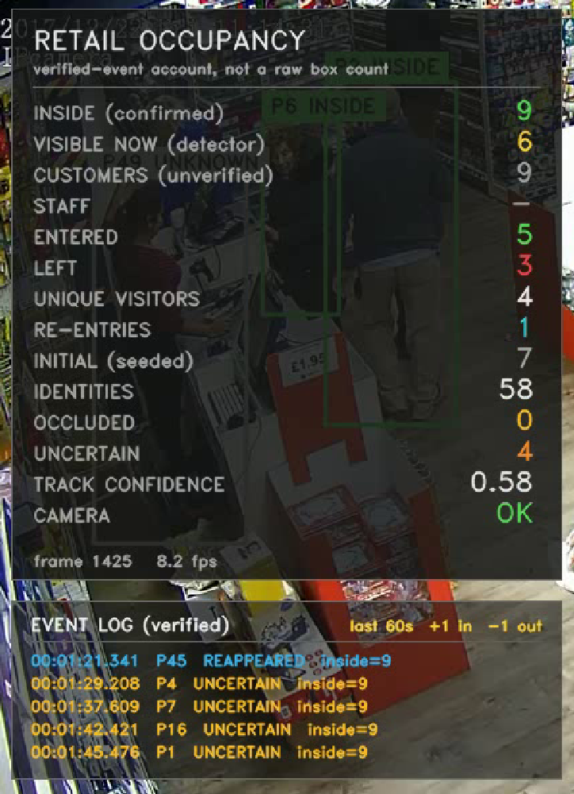
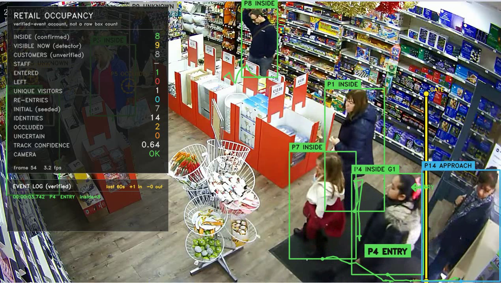
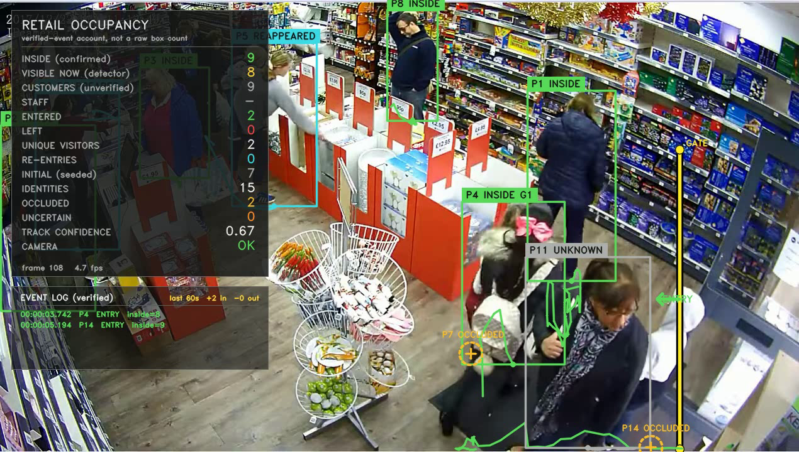
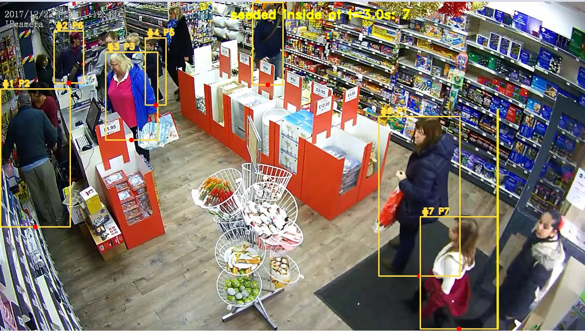
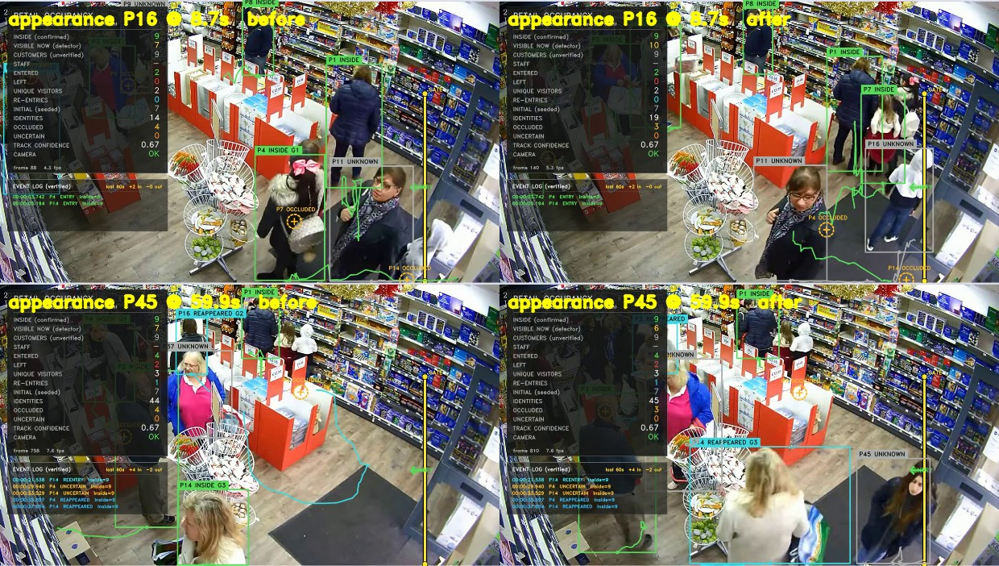

# Store Occupancy & Footfall Monitor (v2)

Counts how many people are **inside** a shop, and how many **entered / left / re-entered**,
from a single fixed CCTV camera — on CPU, with no pre-training, and with every number
traceable to a logged event.

The governing rule of this build:

> **Occupancy changes only on a verified event.** A bounding box disappearing is never
> evidence that a person left. A line crossing is only counted once the person has
> *committed* to the new side. Disappearance creates *uncertainty*, and uncertainty is
> displayed rather than silently resolved.

**On the supplied clip** (111 s, gate at x = 1080): **5 verified entry events** — 4 unique
visitors plus 1 re-entry — **3 verified exits**, **7 people already inside** when recording
began, and **9 confirmed inside** at the end. The detector alone sees between 3 and 13 people
inside at any instant; the difference is occlusion, and both numbers are on screen together.

| Output | File |
|---|---|
| Annotated video: gate, boxes, per-person state, live dashboard, event ticker | `output/annotated.mp4` |
| Verified event log (entries, exits, re-entries, uncertain events) | `output/events.csv` |
| Per-frame timeline (verified occupancy vs detector-visible count) | `output/timeline.csv` |
| Run summary (totals, split by evidence type, camera status) | `output/summary.json` |
| Scenario test suite (23 cases) | `tests/test_system.py` |
| Independent log validator | `build/validate_v2.py` |



*`INSIDE (confirmed)` is the verified-event account. `VISIBLE NOW` is what the detector
actually sees this frame. They disagree whenever people are behind shelving — that gap is the
honest part of the system, not a bug.*



*A verified entry: the person, their identity, their state, and the headcount after the event.*

---

## 1. What was wrong with the first build

The first build (`count_people.py`, kept in this repo as v1 → `output_v1/`) counted a
threshold crossing and treated the visible people as the occupancy. It got the arithmetic
right and the epistemics wrong:

| Failure | Consequence in v1 |
|---|---|
| Disappearance behind a shelf was indistinguishable from leaving | `INSIDE` swung ±3–4 while nothing happened; the number on screen disagreed with the footage |
| A tight simultaneous group entered as one blob | members the detector found only *after* the gate had gone uncounted |
| No identity across a tracker-ID change | a person who lost their ID and was re-created could be counted twice, or not at all |
| No re-entry concept | a returning customer was either a new visitor or invisible |
| Staff and customers were the same population | no defensible customer count |

v2 replaces "count boxes" with a **per-person state machine** and a **double-entry
accounting** of every occupancy change.

## 2. Architecture

```
video.mp4
   │
   ├─ detect      YOLOv8n (COCO person), conf ≥ 0.35, 640 px          ~3.3 fps on CPU
   ├─ track       ByteTrack (ultralytics)  → external ID, ephemeral
   │
   ├─ identity    PersonTrack               → internal person_id, survives ID churn
   │              ├─ appearance signature (HSV histogram)  : proposal only
   │              └─ position + time corroboration          : the actual decision
   │
   ├─ gate        signed distance of the FEET anchor to the vertical line (x = 1080)
   │              commit distance 40 px, flicker gap 4 s, side initialised at 10 px
   │
   ├─ appearance  door-strip presence clusters → entrants the gate never witnessed
   │              (delayed 4 s, then confirmed or vetoed by exit evidence)
   │
   ├─ state       APPROACHING_ENTRY → ENTERED → INSIDE
   │              INSIDE → OCCLUDED → POSSIBLY_EXITED → (UNCERTAIN logged)
   │              OCCLUDED/POSSIBLY_EXITED → REAPPEARED (re-ID recovery)
   │              INSIDE → EXIT_CONFIRMED (only via an outward crossing)
   │
   └─ output      annotated.mp4 + events.csv + timeline.csv + summary.json
```

| Module | Responsibility |
|---|---|
| `retail/geometry.py` | signed distance to the gate line, zone membership |
| `retail/reid.py` | HSV appearance signature + similarity (explicitly *not* a learned embedding) |
| `retail/state.py` | the state and event vocabularies — one place, so nothing is invented ad hoc |
| `retail/tracks.py` | identity lifecycle, verified entry/exit, occlusion, re-ID, groups, occupancy account |
| `retail/appearance.py` | door-strip presence clusters (the simultaneous-group layer) |
| `retail/camera.py` | entrance-coverage checks and warnings |
| `retail/dashboard.py` | boxes, ghosts, HUD panel, event ticker |
| `retail/pipeline.py` | detection loop, seeding, CSV/timeline/summary writers |
| `store_monitor.py` | CLI |

## 3. The state machine

Every person is a `PersonTrack` with an internal `person_id` that is *not* the tracker's ID.
The tracker's ID is a hint; the identity is owned by the system, which is what allows a
person to survive an ID change without being re-counted.

| State | Meaning | Can change occupancy? |
|---|---|---|
| `UNKNOWN` | detected, side not yet resolved | no |
| `APPROACHING_ENTRY` | clearly outside, moving toward the gate | no |
| `ENTERED` | a verified entry just happened | **+1 (already applied)** |
| `INSIDE` | verified member of the store population | no |
| `OCCLUDED` | temporarily not detected, still believed inside | no |
| `POSSIBLY_EXITED` | long absence, no exit evidence — logged `UNCERTAIN` | **no — never** |
| `REAPPEARED` | re-identified after an occlusion (short window) | no |
| `EXIT_CONFIRMED` | outward crossing committed | **−1 (applied at the crossing)** |

The invariant, asserted on every frame by the test driver:

```
occupancy == number of PersonTrack with inside == True
```

### The three ways occupancy can ever change

1. **`seed_initial_occupancy`** — once, at the end of warm-up: people visibly inside whose
   crossing is not in the footage. They are marked `seeded`, counted in occupancy, and can
   never produce an `ENTRY` event.
2. **`_verify_entry`** — a committed inward crossing, a re-ID re-entry with inward
   evidence, or a confirmed door-strip appearance.
3. **`_verify_exit`** — a committed outward crossing. *Nothing else.*

There is no code path that decrements occupancy because a box vanished.

## 4. Entry and exit verification

The gate line stays where it was placed and confirmed: vertical, `x = 1080`, `inside_sign = 1`
(the store is the left-hand side of the frame).

- **Feet anchor, not box centre.** The bottom-centre of the box is the closest cheap proxy
  for floor position, and floor position is what a doorway threshold measures. A box centre
  makes tall people read as arriving early.
- **Commit distance (`commit_px = 40`).** A side is recorded only once the anchor is a clear
  40 px past the line. Standing on the threshold commits nothing.
- **Side initialised cheap, events fired expensively (`init_band_px = 10`).** A new track is
  given a side at 10 px, so somebody whose track starts inside the commit zone can still be
  counted; but crossing still requires 40 px.
- **Flicker gap (`min_event_gap_s = 4`).** The same person cannot produce two events 1 frame
  apart. Crucially the committed side is *kept* when a crossing is suppressed — an earlier
  version that skipped the update swallowed the genuine exit that followed a jitter.
- **Already-counted guards.** An inward crossing by someone already inside, or an outward
  crossing by someone already outside, changes the side but emits no event.

### Re-entry is an entry, but not a new visitor

`_verify_entry` increments `entries_total` always, and `reentries_total` instead of
`unique_visitors` when the person has exited before. So:

```
entries_total == unique_visitors + reentries_total
```

A returning customer raises occupancy, appears in the event log as `REENTRY`, and does not
inflate the visitor count. This is checked by `build/validate_v2.py` and by
`TestReentry.test_exit_then_reentry_with_reid`.

## 5. Occlusion, and why the count does not drop

```
detected ──missing ──▶ OCCLUDED ──still missing 8 s──▶ POSSIBLY_EXITED  (UNCERTAIN logged)
   ▲                                                        │
   └──────────── REAPPEARED (identity re-attached) ◀─────────┘
```

- Missing ≤ 2 frames: nothing happens (detector noise).
- Missing ≤ `occlusion_hold_s = 8`: `OCCLUDED`. No event. Nobody is subtracted.
- Missing beyond that: `POSSIBLY_EXITED`, **one** `UNCERTAIN` row with
  `detail=missing-inside-no-exit-evidence`. Still no subtraction.
- If the person is re-identified: `REAPPEARED`, and a `REAPPEARED` row is written **only if
  they had already been reported uncertain**. Routine short occlusions stay out of the event
  log — a store with shelving would otherwise produce a continuous stream of noise.

The rule that makes the `POSSIBLY_EXITED` state honest is that it is *not* silently resolved.
At the end of the clip some tracks are still in it, and `summary.json` and the HUD report
`UNCERTAIN` separately from `INSIDE`.

This is what the mother-and-child case tests: the child disappears completely behind the
mother, occupancy stays at 2, the child returns as `REAPPEARED`, and never becomes a second
entry.



*States on screen: green boxes are verified `INSIDE`, grey is `UNKNOWN` (not yet counted),
dashed circles are `OCCLUDED` ghosts drawn at the predicted floor position of people the
detector cannot see, and `G1` marks a group. `P7` and `P14` are being carried, not dropped.*

## 6. Re-identification

Re-ID is deliberately weak and deliberately supervised:

> The appearance signature **proposes** an association; position and time **decide** it.

- Signature: 8×8 joint HSV histogram of the person crop (`retail/reid.py`). Cheap enough for
  CPU real time, and explicitly not a learned embedding — so it is used as a proposal, never
  as proof.
- An `OCCLUDED` / `POSSIBLY_EXITED` ghost can only be matched within `reid_radius_px = 260`
  of where it vanished, within `reid_max_gap_s = 180`.
- An `EXIT_CONFIRMED` ghost can only be matched near its **exit point** — the place it was
  last truthfully seen. Matching it anywhere in the frame would let a person walk in the
  front door and be absorbed by someone who left the building five minutes earlier.
- **Door-strip materialisation is never absorbed by an interior ghost.** If the new detection
  is inside the door strip and the ghost vanished deep in the store, the match is refused: one
  is an entrant, the other an occlusion. This guard is the difference between counting the
  8.7 s entrant and silently losing them into a seeded identity — it was found by inspecting
  the frames, and it is pinned by
  `TestIdentitySafety.test_door_materialisation_is_not_absorbed_by_interior_ghost`.
- Re-attaching to an `EXIT_CONFIRMED` ghost does **not** by itself create an entry. If the
  person is still outside, they must cross like anyone else (`APPROACHING_ENTRY`); only a
  person who is *already inside again* (and past the flicker gap) verifies immediately, with
  a lower confidence and the similarity recorded in `detail`.

Failure modes are asymmetric by design: a wrong merge keeps the population right but folds
one person's history into another; a wrong split duplicates a person. Corroboration is
tuned so that a split (visible as two IDs) is preferred over a merge (invisible).

## 7. Simultaneous groups

Two mechanisms, because a group fails in two different ways.

**Group identity.** Entries within `group_window_s = 2.5` and `group_radius_px = 220` of each
other share a `group_id`, drawn on the box as `G3`. Members that later walk apart keep their
group and their identity — tested by `TestGroups.test_members_separate_but_keep_identity`.
A group does not have an occupancy of its own; it is an annotation over verified persons.

**Members the gate never sees.** A tight group enters as one visual blob: one member produces
a committed crossing, the others are first detected already inside. The line cannot count what
it never saw cross, so a second layer watches the door strip (`x = 950…1078`, inside side
only):

- a **presence cluster** is grown from every inside-side detection in the strip, associated by
  external-ID continuity first, then by tight (55 px, ≤ 2 frames) proximity — *tight on
  purpose*, so two people entering side by side are not merged into one presence;
- a cluster is a candidate only if it is sustained (`appear_confirm_frames = 8`), born after
  warm-up, born into space nobody occupied in the last 4 s (kills tracker-churn regains),
  **born at the door** (`_born_at_door`: a track that started deep in the store and merely
  walked into the strip was already inside), not the track of someone already counted inside,
  and not explained by a committed inward crossing just before it was born;
- confirmation is **delayed** `appear_cancel_s = 4` s and then vetoed by any exit evidence: the
  cluster's own minimum distance dipping outward, a committed outward crossing beside it, or a
  feeding track later dipping outside the gate nearby.

The veto is what stops the layer from converting an *undetected exit* into a phantom entry —
tested by `TestAppearanceLayer.test_leaver_in_the_strip_is_vetoed`. The failure mode that
remains is an **under**-count (a genuine entrant born within 85 px of somebody else's recent
anchor), never a spurious over-count.

The layer's own audit trail is in `summary.json → appearance`, and on this clip it is worth
reading, because 12 of 14 clusters were rejected:

| cluster outcome | count | meaning |
|---|---|---|
| `fired` | 2 | verified entrants the gate never saw cross |
| `occupied-area` | 6 | people walking into the strip who were already inside, or churn regains |
| `already-inside` | 1 | the track was already counted inside |
| `cancelled-exiting` | 1 | a leaver — vetoed, an exit was not turned into an entry |
| `initial-occupancy` | 1 | born during warm-up: part of the seed, not an entry |
| `new` (still pending at the end) | 3 | seen but not sustained long enough to confirm |

Confirmed clusters fire one `ENTRY` with `detail=appearance-no-crossing`. The row is
timestamped when the person materialised, but the decision needed the 4 s cancel window, so
`detail` also carries `verified_at=` — the instant occupancy actually changed. The validator
reconciles `timeline.csv` against that field, so the log stays auditable despite the delay.

## 8. Staff and customers

The configured staff zone covers the full service-counter area in the supplied footage. People
are classified as `CUSTOMER` by default, while a person who remains inside that zone for
the configured dwell time is reclassified as `STAFF`. `CUSTOMERS` excludes people with
the staff classification.

The staff rule exists and is tested: a person dwelling `staff_dwell_s = 20` inside a
configured `staff_zone` is classified `STAFF` (logged as `UNCERTAIN` with
`detail=staff-classified-dwell-in-staff-zone`), and only when a zone is configured *and* every
inside person is classified does `customers_reliable` become true
(`TestStaff.test_staff_classification_requires_zone_evidence`,
`TestStaff.test_no_zone_means_no_staff_claim`).

> A number that is not supported by evidence is not reported as if it were.

People first detected clearly inside after warm-up are counted as
`late-detected-inside` entries after a short persistence check, covering crossings hidden
by an occlusion or another person.

## 9. Dashboard

Left panel, per frame:

| Row | Meaning | Rule |
|---|---|---|
| `INSIDE (confirmed)` | verified occupancy | seed + verified entries − verified exits. **Never** drops on disappearance |
| `VISIBLE NOW (detector)` | people detected inside the line this frame | a measurement; fluctuates with shelving |
| `CUSTOMERS (unverified)` | inside population, minus evidence-based staff | upper bound; greyed when unverifiable |
| `STAFF` | classified staff inside | `-` without a staff zone |
| `ENTERED` | verified entry events | crossings + re-ID re-entries + appearances |
| `LEFT` | verified exit events | committed outward crossings only |
| `UNIQUE VISITORS` | entries minus re-entries | re-entries do not inflate this |
| `RE-ENTRIES` | re-entries | a returning customer |
| `INITIAL (seeded)` | inside before the clip could evidence a crossing | initial stock, not entries |
| `IDENTITIES` | internal person identities created so far (`P1`…`Pn`) | includes ID churn — not a visitor count |
| `OCCLUDED` | inside, temporarily undetected | no event, no subtraction |
| `UNCERTAIN` | inside, long absence without exit evidence | occupancy retained |
| `TRACK CONFIDENCE` | mean confidence of inside tracks | how much to trust the identities |
| `CAMERA` | `OK` / `LIMITED` | coverage check, see below |

Below: a `last 60s +in −out` rate, and the **event log (verified)** ticker showing the last
five events with their resulting headcount. On the frame: boxes coloured by state
(green inside, amber occluded, orange possibly-exited, red exited, cyan reappeared), ID and
group labels, foot-anchor dots, walking trails, and dashed-circle **ghosts** at the predicted
position of people the detector cannot currently see.

**Camera coverage** is a first-class check (`retail/camera.py`): if `entrance_fully_visible`
is false, or the gate line leaves the frame, the panel shows `CAMERA: LIMITED` plus a warning
line — because in that situation a *exit* can never be confirmed from disappearance, and the
occupancy is an upper bound by construction.

## 10. Event log format

`output/events.csv`:

```csv
timestamp,person_id,event,headcount,state,confidence,detail
```

| Column | Meaning |
|---|---|
| `timestamp` | `HH:MM:SS.mmm` from the start of the clip (relative, not wall clock) |
| `person_id` | internal identity (`P4` on screen). Survives tracker ID changes |
| `event` | `ENTRY`, `EXIT`, `REENTRY`, `UNCERTAIN`, `REAPPEARED` |
| `headcount` | verified occupancy **after** the event |
| `state` | the person's state when the event was logged |
| `confidence` | evidence strength (0.9 committed crossing, 0.6 appearance, 0.4 uncertain) |
| `detail` | the evidence: `committed-inward-crossing`, `appearance-no-crossing verified_at=…`, `reid-occlusion-recovery sim=0.64`, `missing-inside-no-exit-evidence`, … |

`headcount` is the verified account, so consecutive rows reconcile arithmetically:
`ENTRY`/`REENTRY` = +1, `EXIT` = −1, everything else = 0. `build/validate_v2.py` enforces
exactly that, row by row, against `summary.json` and `timeline.csv`.

`output/timeline.csv` carries, per frame: verified occupancy, detector-visible count,
occluded count, uncertain count — the two numbers that the dashboard deliberately shows side
by side.

## 11. Results — full clip

111 s, 1452 frames, 1270×720, gate at `x = 1080`, CPU only (YOLOv8n @ 640 px). The final
render took 176 s (8.2 fps) with the machine idle; 340–430 s (3.4–3.8 fps) when other work
runs alongside it.

| Metric | Value |
|---|---|
| `ENTRY` events | **5** |
| &nbsp;&nbsp;— committed gate crossings | 3 (`P4`, `P14`, and `P14` again as a re-entry) |
| &nbsp;&nbsp;— door-strip appearances (gate never saw them cross) | 2 (`P16`, `P45`) |
| `UNIQUE VISITORS` | **4** |
| `RE-ENTRIES` | **1** |
| `EXIT` events (committed outward crossings) | **3** |
| `INITIAL (seeded)` at 3 s | 7 |
| `INSIDE (confirmed)` at end | **9** |
| Peak `INSIDE (confirmed)` | **10** |
| `UNCERTAIN` events (occlusion, no exit evidence) | 10 |
| `REAPPEARED` events (recovered uncertainties) | 6 |
| Identities created (`P1`…`P58`) | 58 |
| Raw tracker IDs seen (churn indicator) | 143 |
| Events written | 24 |
| Camera coverage | OK, gate fully in frame |

**Reading the numbers.** The account is `9 = 7 seeded + 5 entries − 3 exits`. Every term is a
logged row or a stated seed, so the total can be audited rather than believed.
`unique_visitors + reentries = entries` → `4 + 1 = 5` ✔.

### The ground truth: 5 people entered

You counted **5 people entering**. The system reports **5 `ENTRY` events**, and the honest
detail behind that number is more useful than the match itself:

| What it is | How the system represents it | Evidence row |
|---|---|---|
| 2 people who crossed the gate on camera | committed inward crossings | `03.742 P4`, `05.194 P14` |
| 2 people the gate never saw cross (group members / late-detected) | door-strip appearance, after a 4 s cancel window | `08.707 P16`, `59.879 P45` |
| 1 person who left and came back | `EXIT` then `REENTRY`, occupancy +1, visitor count unchanged | `17.567` → `21.538`, both `P14` |
| people already past the gate when recording began | `INITIAL (seeded) = 7` — not entries | HUD row, `summary.json` |

Read as people, the five events are **four unique visitors plus one return visit**: `P4`, `P14`,
`P16`, `P45` are distinct people, and `P14`'s second event is the same woman coming back in.
The people who walked in just before the clip started are not entries at all — they are the
seed. `ENTERED` therefore cannot be made to equal "the group of five" by construction: a build
that claimed otherwise would be inventing crossings that are not in the footage.

What v2 did fix on this footage is the other half of the complaint: previously the simultaneous
group was absorbed into the initial-occupancy seed and its later arrivals never counted. The
8.7 s entrant is now verified (`P16`, `appearance-no-crossing`) instead of vanishing into a
seeded ghost.

### Was the seed real? (audit)

The seed is the one number not backed by an event, so it was audited rather than asserted
(`build/seed_audit.py`, `build/warmup_audit.py`):



*The 7 people counted as initial occupancy at the warm-up boundary (t = 2.98 s), numbered.
Red dots are their floor anchors; the yellow line is the gate.*

- 7 distinct bodies, **0 suspected duplicates** (closest pair is 93 px apart with only 0.59
  box overlap — two different people).
- Nobody crossed the gate *during* the 3 s warm-up: the two people nearest the line (the woman
  with the red bag at 903 px, the child at 990 px) are already 177 px and 90 px **inside** at
  frame 0. The only person outside is at 1158 px, and they cross at 3.742 s — which is counted
  as `P4 ENTRY`.
- Lowering the warm-up would therefore not create entries; it would only stop counting people
  who are demonstrably already in the shop.

### The event log, in full

```csv
timestamp,person_id,event,headcount,state,confidence,detail
00:00:03.742,4,ENTRY,8,ENTERED,0.9,committed-inward-crossing
00:00:05.194,14,ENTRY,9,ENTERED,0.9,committed-inward-crossing
00:00:08.707,16,ENTRY,10,ENTERED,0.6,appearance-no-crossing verified_at=00:00:12.679
00:00:13.519,14,UNCERTAIN,10,POSSIBLY_EXITED,0.4,missing-inside-no-exit-evidence
00:00:16.497,6,UNCERTAIN,10,POSSIBLY_EXITED,0.4,missing-inside-no-exit-evidence
00:00:17.414,4,UNCERTAIN,10,POSSIBLY_EXITED,0.4,missing-inside-no-exit-evidence
00:00:17.490,14,REAPPEARED,10,REAPPEARED,0.8,reid-occlusion-recovery sim=0.64
00:00:17.567,14,EXIT,9,EXIT_CONFIRMED,0.9,committed-outward-crossing
00:00:19.705,8,EXIT,8,EXIT_CONFIRMED,0.9,committed-outward-crossing
00:00:20.240,6,REAPPEARED,8,REAPPEARED,0.8,reid-occlusion-recovery sim=0.60
00:00:21.309,4,REAPPEARED,8,REAPPEARED,0.8,reid-occlusion-recovery sim=0.68
00:00:21.538,14,REENTRY,9,ENTERED,0.9,committed-inward-crossing
00:00:29.940,4,UNCERTAIN,9,POSSIBLY_EXITED,0.4,missing-inside-no-exit-evidence
00:00:33.529,14,UNCERTAIN,9,POSSIBLY_EXITED,0.4,missing-inside-no-exit-evidence
00:00:35.897,4,REAPPEARED,9,REAPPEARED,0.8,reid-occlusion-recovery sim=0.59
00:00:37.654,14,REAPPEARED,9,REAPPEARED,0.8,reid-occlusion-recovery sim=0.74
00:00:59.879,45,ENTRY,10,ENTERED,0.6,appearance-no-crossing verified_at=00:01:03.851
00:01:08.434,3,EXIT,9,EXIT_CONFIRMED,0.9,committed-outward-crossing
00:01:11.336,45,UNCERTAIN,9,POSSIBLY_EXITED,0.4,missing-inside-no-exit-evidence
00:01:21.341,45,REAPPEARED,9,REAPPEARED,0.8,reid-occlusion-recovery sim=0.62
00:01:29.208,4,UNCERTAIN,9,POSSIBLY_EXITED,0.4,missing-inside-no-exit-evidence
00:01:37.609,7,UNCERTAIN,9,POSSIBLY_EXITED,0.4,missing-inside-no-exit-evidence
00:01:42.421,16,UNCERTAIN,9,POSSIBLY_EXITED,0.4,missing-inside-no-exit-evidence
00:01:45.476,1,UNCERTAIN,9,POSSIBLY_EXITED,0.4,missing-inside-no-exit-evidence
```

Ten `UNCERTAIN` rows are not noise to be hidden — they are the four people the detector could
not see at the end of the clip (behind shelving, or gone without a witnessed exit) plus the
recoveries along the way. The system says so on the HUD instead of quietly decrementing.

### What the two occupancy numbers look like over time

`timeline.csv`: verified occupancy steps only at events (7 → 8 → 9 → 10 → 9 → 8 → 9) while the
detector-visible count swings between **3 and 13** as people pass behind shelving. The gap
between the two columns *is* the occlusion, quantified: it reaches **6 people** — at exactly the
moments v1's headcount used to plunge.

## 12. Tests

```bash
python -m unittest discover -s tests -v
```

23 scenarios, all synthetic — `TrackManager` is driven frame-by-frame with fabricated boxes,
so the decision logic is exercised without YOLO or a GPU (0.03 s for the suite). The driver
asserts the occupancy invariant on **every** frame, not just at the end:

| Group | Scenario | Asserts |
|---|---|---|
| Entry/exit | one person in and out | 1 entry, 1 exit, occupancy 0, states as expected |
| | flicker at the line | no duplicate entry; the suppressed jitter does not swallow the later exit |
| | simultaneous opposite crossings | one OUT and one IN in the same frame both count |
| Occlusion | mother and child, child hidden | occupancy stays 2, no exit, child `OCCLUDED` → `REAPPEARED` → `INSIDE` |
| | long occlusion | `POSSIBLY_EXITED`, exactly one `UNCERTAIN`, occupancy retained |
| | reappearance with a new tracker ID | re-identified, no new entry, no duplicate identity |
| Groups | four enter together | 4 entries, one shared `group_id` |
| | members separate | group and identity retained |
| | one member hidden | group survives; hidden member is `POSSIBLY_EXITED`, not gone |
| Re-entry | exit then re-enter with re-ID | `REENTRY`, unique visitors stays 1, occupancy rises only at the crossing |
| Staff | dwell in staff zone | `STAFF`, customers 0, reliable |
| | no staff zone | no staff claim, customers flagged unreliable |
| Identity | two similar people cross paths | no merge, 2 identities, 2 entries |
| | dissimilar person near a ghost | no false re-identification |
| | door materialisation vs interior ghost | the entrant is not absorbed — 2 identities, 1 entry |
| Appearance | materialising entrant | exactly 1 entry, `appearance-no-crossing`, identity kept |
| | interior walker into the strip | **rejected** — was already inside |
| | leaver in the strip | **vetoed** — an exit is never converted into an entry |
| Camera | full coverage | no warnings |
| | partial coverage | `LIMITED` + warning |
| | line outside frame | reported, not silently clipped |
| Metrics | accounting identities | entries = unique + re-entries, occupancy = inside set |

Every scenario from the brief's required test list is covered by the groups above, plus the
cases the v2 layers introduced (identity safety, door-strip appearance, camera coverage).
Each test is written as a *story* — "a family of four enters together", "the child is hidden" —
because the failure modes are narrative, not arithmetic.

## 13. Validation

```bash
python build/validate_v2.py            # audits output/ against itself
python build/verify_appearances_v2.py  # before/after frames for appearance entries
python build/seed_audit.py             # who is counted as initial occupancy, and why
python build/warmup_audit.py           # did anybody cross during the warm-up?
python build/make_docs_images.py       # regenerates docs/*.png from the render
```

`validate_v2.py` checks, independently of the code that produced the artifacts: CSV schema;
non-decreasing timestamps; headcount delta per event (+1 / −1 / 0); final headcount vs
`summary.json`; no `EXIT` for somebody who was not inside; no duplicate `ENTRY` without an
intervening `EXIT`; `unique + reentries == entries`; the entry-type breakdown vs the summary;
`timeline.csv` deltas vs the events on that frame (honouring `verified_at=` for backdated
appearance rows); peak occupancy vs the timeline maximum; occupancy never negative.

`verify_appearances_v2.py` extracts the frames ±2 s around every appearance entry so a human
can confirm a person really materialised at the door — the layer's decisions are meant to be
reviewable, not trusted:



*Left: 2 s before each appearance entry the door area is empty. Right: 2 s after, a person is
walking in through the gate with no committed crossing in their history — `P16` at 8.7 s (top)
and `P45` at 59.9 s (bottom). These are the entrants a box-count or a pure line-crossing build
would have lost.*

`seed_audit.py` numbers and draws the initial-occupancy seed and flags duplicate identities
(two tracker IDs on one body) — the seed is the only number in the account that no event
supports, so it gets its own audit. `warmup_audit.py` replays the warm-up window and prints,
per tracker ID, whether its trajectory crossed the gate inside that window. Result on this
clip: no crossings during warm-up, so the seed is not hiding an entry.

## 14. v1 vs v2

| | v1 (`count_people.py` → `output_v1/`) | v2 (`store_monitor.py` → `output/`) |
|---|---|---|
| Occupancy | visible boxes (measurement) | verified-event account, seeded once |
| On disappearance | count drops | `OCCLUDED` → `POSSIBLY_EXITED`, count retained |
| Identity | tracker ID | internal `person_id` + re-ID corroboration |
| Re-entry | impossible to distinguish | `REENTRY` event, not a new visitor |
| Simultaneous group | members found inside were seeded away | door-strip appearance layer + `group_id` |
| Staff/customer | not modelled | evidence-based, `UNKNOWN` by default |
| Uncertainty | none reported | `UNCERTAIN` events, `uncertain_now`, camera warnings |
| Log | 4 columns | 7 columns, evidence in `detail` |
| Verified entries | 5 (3 crossings + 2 appearances) | 5 (3 committed crossings, one of them a re-entry + 2 appearances) |
| Exits | 2 | 3 |
| End occupancy | 7 measured / 13 peak | 9 verified / 10 peak |
| Seeds | 6 | 7 (audited: 7 distinct bodies, 0 duplicates) |
| Tests | none | 23 scenarios |

The two builds agree on the flow total and disagree on what it means — which is the point of
the rewrite. v1's `18.636 IN` is the clearest example: it counted a person who had just left
(v2: `P14 EXIT 17.567`) as a fresh entry one second later, then v2 saw the same person
genuinely return at 21.5 s as a `REENTRY`.

## 15. Limitations — what this system does not claim

1. **The seed is an estimate.** Anyone inside at the warm-up boundary is counted as initial
   occupancy. On this clip that is 7 people, and it is a single measurement, not a verified
   event. It is labelled `INITIAL (seeded)` everywhere and excluded from `ENTERED`.
2. **Verified occupancy is an upper bound, not a census.** A person who leaves through an
   unseen doorway, or is never detected at all, keeps a slot that will never be released.
   The system prefers this to inventing an exit.
3. **Re-ID is a colour histogram.** It distinguishes differently-dressed people; it will merge
   two people in similar clothing if they are also close in space and time. The corroboration
   window is tuned to prefer splits (visible) over merges (invisible).
4. **Staff classification is evidence-based.** People are customers by default; the
   configured service-counter zone and dwell requirement identify staff.
5. **Relative timestamps.** `00:00:03.742` is clip-relative, not the camera's wall clock, and
   the clip's nominal 13.09 fps is assumed constant.
6. **Single camera, single gate.** The gate at `x = 1080` is placed and confirmed for this
   camera; a different mount needs `pick_line.py` and a fresh `inside_sign`.
7. **The appearance layer is conservative by design.** Its failure mode is an under-count of
   entrants who materialise within 85 px of somebody else's recent anchor.
8. **Throughput is 3.4–8.2 fps on CPU** (YOLOv8n, 640 px, depending on machine load). It is
   not real time at 13 fps; it is near-real-time analytics on recorded footage.

## 16. Running it

```bash
pip install -r requirements.txt

python store_monitor.py                      # full clip -> output/
python store_monitor.py --seconds 30         # quick verification render
python store_monitor.py --no-video           # metrics only, no rendering
python store_monitor.py --out-dir out_test   # separate artifact directory

python -m unittest discover -s tests -v      # 23 scenario tests
python build/validate_v2.py                  # audit output/
python count_people.py                       # legacy v1 -> output_v1/ (comparison only)
```

`config.json` holds every tunable: gate line, `inside_sign`, commit distance, flicker gap,
occlusion hold, re-ID thresholds, group window, staff zone, door strip, detector settings.

```
retail/          v2 system (this document)
store_monitor.py v2 CLI
tests/           23 synthetic scenario tests
build/           validators, diagnostics, docs image generation
output/          v2 artifacts (submission)
output_v1/       legacy v1 artifacts (comparison)
docs/            README images
```

## 17. Review questions, answered plainly

**"Your seed is 7 but only 5 people entered. Isn't that wrong?"**
They answer different questions. `INITIAL (seeded) = 7` is how many people were already
inside when the recording started; `ENTRY` events are crossings the footage actually
contains. Adding them is the occupancy, and subtract the exits: 7 + 5 − 3 = 9. The alternative
— forcing `ENTERED` to equal the group size — would require inventing crossings for people
whose crossing was never filmed.

**"Why not just count the boxes? It's one line of code."**
Because the count then follows the detector, not the shop. On this footage the visible
population swings between 5 and 10 with nothing happening. The verified account moves only
when somebody crosses, and the HUD shows both numbers so the disagreement is inspectable.

**"How do you know a disappearance isn't an exit?"**
I don't — that is exactly the point. It is labelled uncertain, occupancy is retained, and the
`UNCERTAIN` event records that a human may need to check. Claiming knowledge I don't have
would be the bug.

**"What stops the appearance layer from inventing entrants?"**
Four independent vetoes (sustained presence, empty-space birth at the door, no crossing
already explaining it, no exit evidence within the cancel window) and a test that a leaver in
the strip is never converted into an entry. Its remaining failure mode is an under-count.

**"Is the re-entry at 21.5 s real, or is that the tracker?"**
It is the same internal identity (`P14`) that exited at 17.6 s, re-attached by appearance plus
position, and it then made a **committed inward crossing** of the line at 21.5 s. The entry is
supported by a crossing, not by an appearance alone.

**"What would you do with more time?"**
A learned re-ID embedding (OSNet) instead of an HSV histogram; a per-camera calibration for
the seed; door-strip depth instead of an x-band; and a second camera to break the
single-view occlusion ambiguity.
